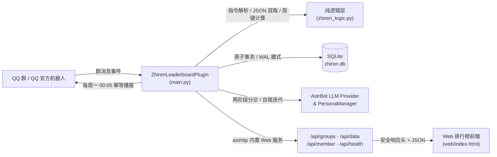

# 智人排行榜 (`astrbot_plugin_zhiren_leaderboard`)

面向 [AstrBot](https://github.com/AstrBotDevs/AstrBot) 的群聊即时记分、AI 自动裁判、机器人对抗学习自我迭代与内置 Web 排行榜插件，原生兼容 OneBot / QQ 群与 QQ 官方机器人。

---

## 功能一览

- **即时群聊记分**：群里发 `@某成员 加一分 理由`（`+1`）或 `@某成员 扣一分 / 减一分 理由`（`-1`）。强制附理由、禁止给自己记分、10 秒内重复消息自动去重，并支持 QQ 官方机器人 `<@uid>` 纯文本艾特解析。
- **高可靠 SQLite 存储**：成员昵称、积分与历史记录实时落库（SQLite WAL 模式 + 原子事务 + 锁保护），各群数据完全隔离；昵称缺失/退化为 QQ 号时自动异步拉取群名片治愈。
- **排行榜与个人详情查询**：支持 `@机器人` 查询总分榜、本周榜、**倒序榜（垫底榜）**、个人详情（总分、本周变动、最近 20 条记录）及模糊昵称搜索。
- **每周一自动播报**：东八区每周一 `00:05` 自动向有记录的群幂等播报上周排行榜（防止重复发送）。
- **AI 裁判（两阶段持续监听）**：
  - 管理员可分群开关，开启后监听群内最近 60 条非 `@bot` 发言（自动过滤手动记分指令，防止与人工记分双重计分）。
  - **两阶段判决**：证据确凿（如针对具体人的恶意辱骂、露骨骚扰等）立即判罚并引用原消息公示；品行类疑似进入观察期（最长 5 分钟）结合群友反应复议；每次判罚与加分固定 `±1` 分，同一事件只判一次。
  - **支持专项裁决**：`@机器人 评价 @某人` 或 `@机器人 评价` 随时手动开庭。
- **机器人对抗学习（自我迭代）**：`@机器人 加/扣一分 理由` 不计入排行榜，自动沉淀为反馈池；过滤无信息量噪声后由 LLM 增量维护行为准则并写回当前人格与裁判边界。
- **内置安全 Web 排行榜**：独立单文件 Web 页面（无外部 CDN 依赖），支持选群切换、本周榜/总分榜、正序/倒序、实时搜索、前三名领奖台、成员详情抽屉、键盘无障碍与 30 秒自动刷新；默认启用安全响应头与零 `innerHTML` 的 DOM API 防 XSS 渲染。

---

## 系统架构



---

## 安装与配置

### 1. 安装插件

将本仓库克隆至 AstrBot 的 `data/plugins/` 目录下并重启 AstrBot：

```bash
cd <AstrBot根目录>/data/plugins
git clone https://github.com/yunyancuo/astrbot_plugin_zhiren_leaderboard.git
```

数据文件默认保存在 `<AstrBot根目录>/data/plugin_data/astrbot_plugin_zhiren_leaderboard/zhiren.db`。

### 2. 环境变量与配置项

所有配置项均支持通过**环境变量**设置（同时也兼容插件配置字典传入），零配置即可开箱使用：

| 环境变量 | 插件配置键 | 默认值 | 说明 |
| --- | --- | --- | --- |
| `ZHIREN_WEB_PORT` | `web_port` | `6201` | 内置 Web 排行榜监听端口（非法值自动回退 `6201`） |
| `ZHIREN_WEB_HOST` | `web_host` | `0.0.0.0` | 内置 Web 排行榜监听地址（反代场景可设为 `127.0.0.1`） |
| `ZHIREN_SUPER_ADMIN` | `super_admins` | 空（回退 AstrBot 管理员） | 可执行「重置分数」的超级管理员 ID，多个 ID 用逗号分隔；未配置时自动回退校验 AstrBot `admins_id` / 管理员权限 |
| `ZHIREN_PUBLIC_URL` | `public_url` | 空 | 可选的公开排行榜访问链接（配置后将在群内榜单和帮助文案中附带该链接） |
| `ZHIREN_CORS_ORIGIN` | `cors_origin` | 空（仅同源） | 可选的 CORS 允许来源（按需开启，默认同源更安全） |
| `ZHIREN_DATA_DIR` | `data_dir` | AstrBot `plugin_data` 目录 | 自定义 SQLite 数据存储目录 |

> **安全说明**：开源版本不包含任何硬编码个人 QQ 号或私人域名。若需要指定专属超级管理员，请配置环境变量 `ZHIREN_SUPER_ADMIN="你的QQ号"`；未显式配置时，仅 AstrBot 框架配置的管理员可执行重置操作。

---

## 指令大全

### 记分指令（群内直接发送，无需 `@机器人`）

| 指令示例 | 效果 |
| --- | --- |
| `@某成员 加一分 帮忙修好线上 Bug` | 目标成员 `+1` 分（同义词：`加1分`） |
| `@某成员 扣一分 开会放鸽子` | 目标成员 `-1` 分（同义词：`减一分`、`扣1分`、`减1分`） |
| `@机器人 加一分 / 扣一分 理由` | 向机器人提交评分反馈（不进排行榜，沉淀至自我迭代反馈池） |

### 查询与管理指令（需 `@机器人` 触发）

| 指令示例 | 权限 | 说明 |
| --- | --- | --- |
| `帮助` / `指令` / `help` | 所有人 | 查看使用说明 |
| `周榜` / `本周排行` | 所有人 | 查看本周排行榜（前 25 名） |
| `总分榜` / `总分` / `排行榜` | 所有人 | 查看总分排行榜（前 25 名） |
| `周榜 倒序` / `总分榜 倒序` / `垫底榜` | 所有人 | 按分数从低到高倒序查看 |
| `查询 @某人` / `查询 昵称` / `查询 QQ号` | 所有人 | 查看指定成员总分、本周变动与最近 20 条记录 |
| `我的得分` / `我的总分` | 所有人 | 查看个人得分详情 |
| `AI裁判 状态` | 所有人 | 查看本群 AI 裁判开关与上下文缓冲状态 |
| `AI裁判 开` / `AI裁判 关` | 管理员 | 开启或关闭本群 AI 裁判 |
| `评价 @某人` / `评价 昵称` | 所有人（需开启 AI 裁判） | 对指定成员近期发言进行专项裁决 |
| `评价` | 所有人（需开启 AI 裁判） | 对当前未审议发言立即开庭 |
| `迭代状态` / `行为准则` | 所有人 | 查看机器人自我迭代反馈池与当前行为准则 |
| `立即迭代` | 管理员 | 手动触发一轮自我迭代（后台异步执行） |
| `重置分数` → 30 秒内 `确认重置` | 超级管理员 | 二次确认后清空本群全部积分与记录 |

---

## Web 排行榜与反向代理部署

启动插件后，直接访问 `http://<服务器IP>:<ZHIREN_WEB_PORT>` 即可打开排行榜页面，内置 HTTP 接口包括：

- `GET /`：排行榜单页应用
- `GET /api/health`：服务健康检查（返回 `{"status": "ok", "version": "..."}`）
- `GET /api/groups`：群列表及记录数统计
- `GET /api/data?gid=<群号>`：指定群的总分榜与本周榜数据
- `GET /api/member?gid=<群号>&uid=<成员ID>`：指定成员详情与最近 20 条记录

### Nginx 反向代理参考

若将服务部署在 ECS 并通过域名或子路径暴露，建议将 `ZHIREN_WEB_HOST=127.0.0.1` 并使用 Nginx 反向代理：

```nginx
location = /zhiren {
    proxy_pass http://127.0.0.1:6201/;
    proxy_set_header Host $host;
    proxy_set_header X-Real-IP $remote_addr;
}

location /api/ {
    proxy_pass http://127.0.0.1:6201/api/;
    proxy_set_header Host $host;
    proxy_set_header X-Real-IP $remote_addr;
}
```

---

## 项目结构

- `main.py`：AstrBot 插件入口（群消息分发、SQLite 原子事务管理、AI 裁判、自我迭代、周榜定时播报、内置 aiohttp Web 服务）
- `zhiren_logic.py`：无框架依赖的纯逻辑层（指令解析、周键与东八区时区计算、`JSONDecoder` 安全提取、输入校验与转义）
- `web/index.html`：单文件 Web 排行榜前端（纯 DOM API 安全渲染、无外部依赖）
- `tests/`：离线单元测试与集成测试套件（无需 AstrBot 运行时即可执行）
- `metadata.yaml`：AstrBot 插件元数据描述
- `pyproject.toml`：Ruff 与 Pytest 项目配置

---

## 开发与测试

本项目支持完全离线运行静态检查与自动化测试（无需启动真实 AstrBot 或 QQ 机器人）：

```bash
# 安装开发依赖
pip install aiohttp pytest pyyaml ruff

# 静态代码检查
ruff check .

# 运行全部单元测试与集成测试
pytest -v
```

---

## 许可证

基于 [MIT License](LICENSE) 开源。
